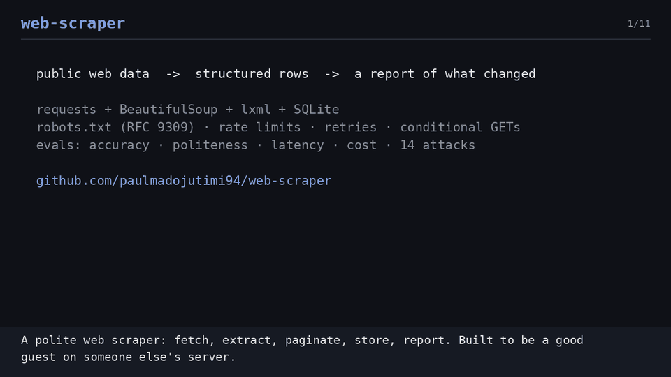
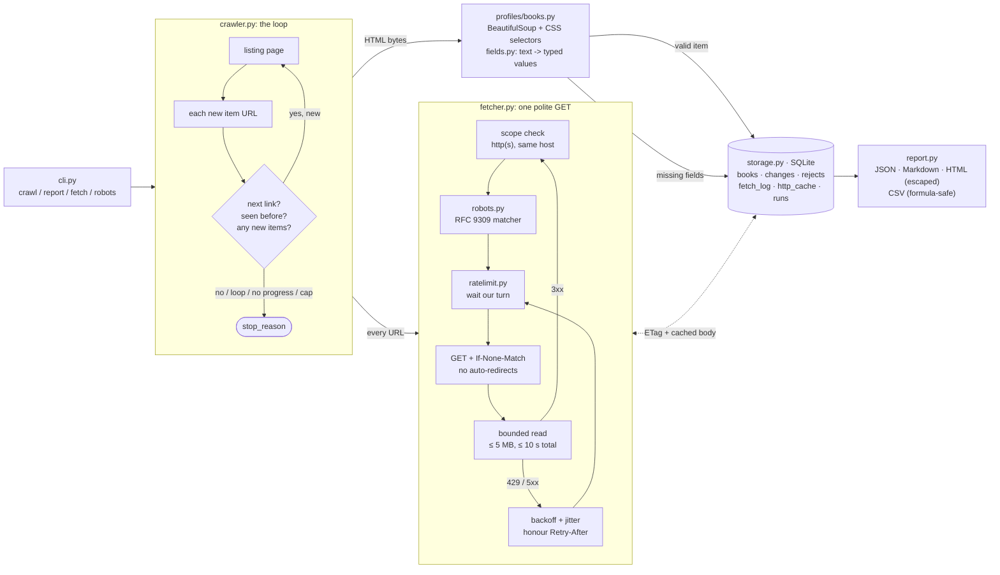

# web-scraper

[](https://github.com/paulmadojutimi94/web-scraper/actions/workflows/ci.yml)

**Point it at an online shop's catalogue and get back a clean database of every product, a report of what changed since last time, and a server that never noticed you were there.**

> **Status:** v0.1. Python 3.11+, `requests` + `BeautifulSoup` + `lxml`, nothing else. 78 tests. Accuracy, politeness, rerun, latency, cost and attack evals measured; CI checks the robots.txt matcher on Python 3.11, 3.12 and 3.13.

**Demo (3 min, plays below):** every screen is real output. Narration script in [docs/DEMO.md](docs/DEMO.md); MP4: [download web-scraper-demo.mp4](https://github.com/paulmadojutimi94/web-scraper/raw/main/docs/demo/web-scraper-demo.mp4).



**Learn from it:** [docs/LEARN.md](docs/LEARN.md) teaches HTTP, BeautifulSoup and parsing through this code, with exercises.
**Sample output:** [examples/](examples/): the terminal output of a demo run and the four reports it wrote.

## The problem

A website is a shop window built for people. You can *see* that "A Light in the Attic" costs £51.77, has three stars and 22 in stock, but to a program the page is thousands of characters of HTML. Scraping is turning that window display back into a spreadsheet: **fetch** the page, **extract** the facts, **follow "next"** to the other 49 pages, **store** the rows, **report** on them.

The code for that fits on a napkin. What makes it hard is that you're a guest in someone else's shop:

| The shop... | A naive scraper... | This one |
|---|---|---|
| puts up a sign saying "staff only" (`robots.txt`) | walks in anyway | reads the sign first, using the standard's rules (RFC 9309) |
| has one till and a queue | sends 50 requests a second | waits ≥ 1 s between requests, longer if the sign says so (`Crawl-delay`) |
| says "busy, come back in 2 minutes" (`429` + `Retry-After`) | retries immediately, forever | backs off, honours the wait, gives up after 3 tries |
| hasn't changed since yesterday | downloads everything again | asks "anything new since this version?" (`ETag`) and gets a body-less "no" (`304`) |
| has a corridor that loops back on itself | walks it forever | notices it's been here before and leaves |

And some pages are hostile on purpose: a 20 MB "product page", a server that drips one byte every quarter-second, a redirect to an internal address, a book titled `=HYPERLINK(...)` that becomes a live link when the CSV is opened in Excel. A scraper is a program that runs code-shaped text from strangers through your database and spreadsheets, so it needs the same defences as anything else exposed to the internet.

The default target is [books.toscrape.com](https://books.toscrape.com), a public sandbox built for scraping practice. Everything is measured against a **local copy** of that site (`src/testsite/`), which generates 1,000 books with planted mess and remembers the right answer for every field, so accuracy can be measured exactly and the evals never put load on anyone's real server.

## What it does

```text
$ make demo
--- run 1: first visit ---
run 1: 50 listing + 990 item pages | 982 new, 0 changed, 0 unchanged, 8 rejected, 10 blocked, 0 failed | stop: done | 12.6s
  outcomes: ok 1040, robots_blocked 10

--- run 2: same site, nothing changed ---
run 2: 50 listing + 990 item pages | 0 new, 0 changed, 982 unchanged, 8 rejected, 10 blocked, 0 failed | stop: done | 2.3s
  outcomes: not_modified 1040, robots_blocked 10

--- the shop changes some prices and stock ---
run 3: 50 listing + 990 item pages | 0 new, 81 changed, 901 unchanged, 8 rejected, 10 blocked, 0 failed | stop: done | 2.6s
  The Broken Harbour                           £56.44 ->    £64.78
  The Burning Daughter (Revised Edition)       £44.79 ->    £37.70
  ...50 price changes in total
```

`rejected` are pages planted broken (no price, no UPC, no title): they're logged with the reason, never half-stored. `blocked` are links into a folder robots.txt disallows: not one request was sent to them. The second run downloads almost nothing (61 bytes of body against 2.1 MB) because the server answered every page with `304 Not Modified`. The third finds exactly the prices the site changed. Each run writes [`report.md`](examples/report.md), [`report.html`](examples/report.html), [`books.csv`](examples/books.csv) and [`summary.json`](examples/summary.json).

## Architecture



Think of it as a **mystery shopper with a clipboard**. The **crawler** is the route: start at aisle 1, note every product, follow the "next aisle" sign, and leave if a sign points back to an aisle already visited. The **fetcher** is good manners at each door: check the opening hours on the door (`robots.txt`), queue (`ratelimit`), leave if the shopkeeper says "come back later", and walk away from anyone who tries to hand over a 20 MB leaflet. The **profile** is the clipboard template: which shelf label holds the price, which holds the stock. **Storage** is the filing cabinet, which keeps both today's prices and a note of every price that moved. **Report** is the summary for the boss.

Five decisions do most of the work (the [design doc](docs/DESIGN.md) has the alternatives that lost):

1. **Our own robots.txt matcher, not Python's.** The gold set showed `urllib.robotparser` gives different answers on different Pythons: on 3.11/3.12 it fetches pages that the site disallowed (first-match instead of longest-match, no `*` or `$`), and even 3.13 ignores the rules in a file that starts with a byte-order mark. ~150 lines written against RFC 9309 give the same 18/18 on every version.
2. **Bytes go to the parser, not `response.text`.** `requests` decodes any `text/*` page with no charset header as ISO-8859-1, which is why so many tutorials print `£51.77`. BeautifulSoup gets the raw bytes and reads the page's own `<meta charset>`.
3. **Redirects are followed by hand.** `allow_redirects=False`, then every hop goes back through the scope and robots checks. Automatic redirects would let a page bounce the scraper to `http://169.254.169.254/` (the cloud metadata server) or to a disallowed path.
4. **Money is whole pence.** `float("1.15") * 100` is `114.99999999999999`. Prices are parsed with `Decimal` and stored as `INTEGER` pence.
5. **Change detection is a content hash per book.** Same hash means nothing to write. A different hash means record exactly which fields moved in `changes`. Together with conditional GETs (`304`) and skipping the parse for unchanged pages, an unchanged rerun downloaded 61 bytes of body instead of 2.1 MB and took 2.3 s instead of 12.6 s in the demo.

## Try it in one minute

```bash
git clone https://github.com/paulmadojutimi94/web-scraper && cd web-scraper
pip install requests beautifulsoup4 lxml

make demo                        # local test site: crawl, rerun, change, rerun (no internet needed)

# the real sandbox site, politely (1 request/second: ~18 minutes for all 1,000 books)
PYTHONPATH=src python3 -m scraper crawl --max-pages 60 --report-dir reports
PYTHONPATH=src python3 -m scraper robots https://books.toscrape.com/catalogue/page-1.html
PYTHONPATH=src python3 -m scraper fetch https://books.toscrape.com/ --show 300

make serve                       # practise against the local site in a browser or with the CLI
```

Also: `make test` (78 tests, ~15 s), `make eval` (every eval, ~4 min, rewrites the table below), `make lint`. The CLI refuses `--delay` below 0.5 s for anything that isn't `localhost`.

## Eval results

All reproducible with `make eval`, which rewrites this table from `evals/results/`. CI fails if this table drifts from those files.

<!-- results:start -->
| What | Result | How it was measured |
|---|---|---|
| **Books stored exactly right** (all 8 fields) | **100.0%** (4,912 / 4,912) | 5 held-out test sites (seeds 100-104), 1,000 books each, compared with the generator's answer key |
| Fields right | 100.0% (39,296 / 39,296) | Same crawl, field by field |
| Missing / extra books | 0 / 0 | Same crawl |
| Broken pages rejected | 48 / 48 (good pages rejected: 0) | Pages planted with no price, UPC or title |
| **Hand-written gold set** | **44 / 44** | Real-world HTML and robots.txt cases, frozen before the first run (first run: 34 / 44) |
| robots.txt matcher, per Python version | 18 / 18 on 3.11, 3.12 and 3.13 | Python's own urllib.robotparser on the same cases: 3.11: 12/18 (4 unsafe); 3.12: 12/18 (4 unsafe); 3.13: 16/18 (1 unsafe) |
| **Requests to robots-disallowed pages** | **0** | Server-side log of 5,922 requests |
| **Requests closer together than the delay** | **0 / 584** | Timed as each request leaves (0.5 ms tolerance); 4 runs, server in its own process, incl. a robots.txt Crawl-delay longer than ours. Server-side clock agrees within 20 ms (0 outside; worst 8.6 ms short) |
| Requests without our User-Agent | 0 | Same log |
| Price changes found on a rerun | 253 / 253 (false alarms: 0) | Site changes 5% of prices between visits |
| Stock changes found | 166 / 166 (false alarms: 0) | Site changes 3% of stock counts |
| **Rerun, nothing changed** | **99.2% answered 304**, 61 bytes of body vs 2.1 MB the first time, 0 false changes | Conditional GET (ETag); unchanged pages aren't re-parsed |
| **Latency per request** (local server) | **p50 1.39 ms, p95 1.95 ms** | 5,091 first-attempt fetches. Network-free: a real site adds its round trip |
| Parse time per page | item p50 1.66 ms, p95 2.83 ms; listing p50 7.09 ms | BeautifulSoup + lxml + CSS selectors, 1,000 pages |
| Crawl 1,000 books (no delay, local) | 16.24 s first run, 2.02 s rerun | Median of 5 sites; includes ~5 s of planted 503/429 retries |
| **Same crawl at the polite default** | **~17.8 min** | 1 request/second: politeness, not code, sets the speed |
| **Cost per run** | **€0.00** | 0 paid APIs; 1.086 requests and 2.1 KB per book |
| **Attack success rate**, all defences on | **0 / 14 (0%)** | 14 hostile pages, evidence from the server log, database and report files |

| Attack | Defence switched off | Gets through with it off? |
|---|---|---|
| link to a page robots.txt disallows | `respect_robots=False` | yes |
| page 3's 'next' points back to page 1 | `guard_visited=False` | yes |
| 'next' forever, same items on every page | `guard_no_progress=False` | yes |
| item redirects to another host (SSRF-style) | `guard_scope=False` | yes |
| 20 MB response with no Content-Length | `max_bytes=None` | yes |
| server says nothing for 3 s | `timeout_s=None` | yes |
| headers at once, then 1 byte every 0.25 s | `guard_total_time=False` | yes |
| 429 with Retry-After: 2 | `honor_retry_after=False` | yes |
| an image/png that contains a book page | `check_content_type=False` | yes |
| title is a <script> tag | `escape_html=False` | yes |
| title is an Excel formula | `guard_formulas=False` | yes |

Measured on Linux x86_64, Python 3.13.18.
<!-- results:end -->

How to read it:

- **The 100% rows are the weakest evidence here.** The test site and the scraper were written by the same author, so a perfect score mostly proves the scraper handles the mess I *thought of*. That's why the **gold set** exists: 44 hand-written cases in formats the generator never makes (a struck-through sale price, `<base href>`, `rel="next"`, `UPC:` with a colon, a robots.txt with a byte-order mark, `Crawl-delay: 2.5`, wildcard rules), committed in `3b1cf78` *before* the scraper ever ran on them. Its first run scored 34 / 44. How that was found and fixed is the [postmortem](docs/POSTMORTEM.md). Because those fixes were made, the gold set is no longer blind; the next one has to come from real sites (Next steps).
- **Fail safe vs fail silent.** Of the 10 first-run gold failures (on Python 3.13), 2 were *impolite*: a robots.txt starting with a byte-order mark was read as "no rules", and `Crawl-delay: 2.5` was ignored. 2 stored wrong data silently (the struck-out sale price, a missing stock count), 5 lost data (pages rejected over a `UPC:` label, wrong URLs from `<base href>`, pagination stopping at page 1), and 1 was harmless (a `javascript:` link the fetcher would have blocked anyway). The impolite ones were the worst kind: no error, no log line, just requests that shouldn't have happened. On Python 3.11 or 3.12, the same robots cases add 3 more unsafe answers.
- **Held-out seeds.** Everything was built and debugged on seed 0 and small sites; the published numbers come from seeds 100-104.
- **Politeness is measured from both ends.** Each request is timestamped as it leaves (that's where the rate limiter decides), and the server, running in its own process, logs it as it arrives. The server's timestamps jitter by a few ms (thread scheduling), so they're checked with a 20 ms tolerance. One earlier full run of this eval saw a single client-side gap 2.5 ms short out of 584 that didn't reproduce: a pause inside Python between the limiter marking the send and the timestamp being taken (see Known failures).
- **p50 and p95:** half of the requests were faster than p50; 95 in 100 were faster than p95. These are against a server on the same machine, so they measure *this code*, not the internet. On the real site, your network's round trip (typically 20-200 ms) is added, and the 1 s politeness delay dwarfs both.
- **The ablation table is the point of the attack eval.** 0 / 14 with every defence on could just mean the attacks were weak. Switching each defence off makes its attack succeed: the scraper really does fetch `/admin/secret.html`, follow the redirect to the "internal" host, download all 20 MB, wait the full 6 s for the drip, and write a live `=HYPERLINK` into the CSV. Three attacks have no off switch: SQL injection (queries are always parameterised; there is no unsafe code path to switch to), the hidden honeypot link (the profile only follows links in product cards) and the 503 storm (retries are always capped).

## Known failures

- **One site profile.** Only the books.toscrape.com layout is understood. Another site needs a new profile class (two methods, ~60 lines). There's no generic "find the products on any page" mode, on purpose: guessing produces confident wrong data.
- **No JavaScript.** Pages that build their content in the browser (React, infinite scroll) arrive empty. That needs a headless browser (Playwright), which is far heavier per page.
- **Not verified against the live site from the build machine.** The build sandbox couldn't reach books.toscrape.com (its network proxy refused the host), so every number above comes from the local copy, whose HTML follows the real site's markup. The first real run is Next step 1.
- **The answer key and the parser share assumptions.** The generator plants the mess I imagined. The gold set narrows the gap, it doesn't close it.
- **Single-threaded, one host.** One request at a time, to one site. That's deliberate for politeness, but a multi-site crawl would need a per-host queue and workers.
- **The cache lives in the database.** Every page body is kept for conditional GETs: ~2 MB per 1,000 books here, but a big site would want it on disk or compressed.
- **Disappeared books are only reported after a complete crawl.** If a run stops early (`max_pages`, error), the report can't tell "gone" from "not reached", so it says nothing.
- **A stock count that the page doesn't show can't be tracked.** "In stock" with no number stays `NULL`. (The first version of the eval counted those as misses. That was an eval bug, see the postmortem.)
- **Robots rules are cached for the whole run.** A robots.txt that changes mid-crawl is picked up next run. RFC 9309 allows caching for up to 24 h.
- **The gap guarantee is "at least the delay, give or take a few milliseconds".** The limiter records the instant before each send, but Python can pause (garbage collection, the OS scheduler) between that and the bytes leaving. One eval run in two saw a single gap 2.5 ms short out of 584. No server could tell the difference, but the claim is the honest one: ≥ delay minus a few ms, measured, not "never less".

## Postmortem

**[Full write-up in docs/POSTMORTEM.md](docs/POSTMORTEM.md).** The headline incident:

- **What happened.** The accuracy eval said 100%: every one of ~5,000 books right, 0 requests to disallowed pages. The first run of the hand-written gold set said 34 / 44, and two of the failures were robots.txt cases the scraper got wrong *in the impolite direction*.
- **How it was found.** The gold set was committed before the scraper ran on it (`3b1cf78`), so it couldn't be quietly adjusted. Chasing the robots failures, I ran the same cases through Python 3.11 and 3.12 as well: 4 unsafe answers there, 1 on 3.13. The scraper's politeness depended on which Python it ran on.
- **Root cause.** I'd trusted `urllib.robotparser` as "the standard library, so it implements the standard". It predates RFC 9309. Older versions take the first matching rule instead of the longest and treat `*` as a literal character. The test site's robots.txt only used simple prefix rules, which every version gets right, so the 100% accuracy run could never have caught it.
- **Impact.** On Python 3.11 or 3.12, a site saying `Allow: /catalogue/` then `Disallow: /catalogue/private/` would have had its private folder crawled. That's the kind of mistake that gets an IP address banned, and it's a breach of the site owner's stated wishes.
- **Fix and guard.** A ~150-line RFC 9309 matcher (longest match, Allow wins ties, `*` and `$`, BOM, decimal Crawl-delay), 18 / 18 on all three Pythons. CI runs the tests on 3.11, 3.12 and 3.13, and `evals/robots_stdlib_compare.py` keeps recording how the stdlib behaves.

It also covers a timeout that didn't time out (a server dripping one byte every 0.25 s held a "1-second" request for 6 s), a rate limiter that ignored the `Crawl-delay` it had just read, a rerun that was no faster than the first crawl, and two bugs in the evals themselves.

## Next steps

1. **Run it against books.toscrape.com from a normal machine** (`--max-pages 60` first) and add every page it gets wrong to a second, frozen gold set before changing code.
2. **A second profile** (e.g. quotes.toscrape.com) to prove the profile boundary is in the right place, then a small declarative profile format (selectors in TOML) for simple sites.
3. **Sitemaps:** read `Sitemap:` lines from robots.txt and use `<lastmod>` to fetch only what changed, instead of walking every listing page.
4. **Faster parsing:** two-thirds of a crawl's CPU time is BeautifulSoup building the tree (cProfile). `SoupStrainer` (parse only `div.product_main` and the table) or plain `lxml.html` with XPath should halve it.
5. **Scheduling + alerts:** a nightly scheduled run, with an alert when the reject rate jumps (a sign the site's HTML changed and the profile needs updating).
6. **JavaScript sites:** an optional Playwright fetcher behind the same `FetchResult` interface, used only for profiles that need it.

## Repo map

| Path | What's there |
|---|---|
| `src/scraper/` | The scraper, one module per job ([CLAUDE.md](CLAUDE.md) has the map) |
| `src/scraper/profiles/books.py` | The only site-specific code: selectors and field extraction |
| `src/testsite/` | The local practice site: generator, HTML pages, server with hostile routes |
| `tests/` | 78 tests: fields and URLs, robots and rate limiting, fetcher against a live local server, profile, crawl/store/report, CLI |
| `evals/` | Accuracy, gold set, politeness, attack evals; `run_all.py` writes the table above |
| `evals/gold/cases.py` | The 44 frozen gold cases |
| `evals/results/` | The numbers those evals produced, including the gold set's first run |
| `examples/` | Real output from `make demo` |
| `scripts/demo.py` | The demo |
| `docs/DESIGN.md` | One-page design doc: decisions and the alternatives rejected |
| `docs/POSTMORTEM.md` | What went wrong and how it was found |
| `docs/CHEATSHEET.md` | Every line of the code explained, for technical interviews |
| `docs/LEARN.md` | HTTP, BeautifulSoup and parsing taught through this code, with exercises |
| `docs/DEMO.md`, `docs/demo/` | The 3-minute demo (GIF, MP4), its narration, and `make_video.py`, which rebuilds both |
| `.github/workflows/ci.yml` | On every push, on Python 3.11, 3.12, 3.13: lint, tests, gold set, attacks, README check, demo |
| `CLAUDE.md` | The guide for AI agents working in this repo |

MIT-licensed. Scrape responsibly: robots.txt is a request, not a lock, and this tool is built to honour it.
